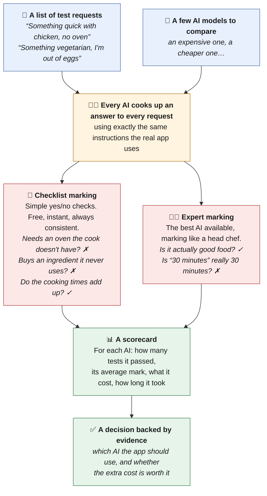

# CookingOS Evals: testing an AI chef with numbers instead of gut feel

**CookingOS** is a cooking app built around an AI chef called **John**. You tell John what you
fancy in one line ("something quick with chicken, no oven"). He writes a complete three-dish meal
for your kitchen, then answers your questions while you cook ("I've run out of lemons, what now?").

This repository is the **evaluation harness** behind John. It is a test bench that answers
practical questions like these:

> *Which AI model should write the recipes? Is the more expensive one actually better, or just more
> expensive? If we switch to a cheaper model for mid-cook questions, what gets worse?*

Without a test bench, those decisions are guesses. With one, each is a table of scores and costs.

---

## The idea in one picture



**In words:** write down realistic requests. Pick the AI models you want to compare. Every
model answers every request, using the app's real instructions. Each answer is marked twice:
once against a checklist and once by an expert AI judge. Everything lands on one scorecard, and
the scorecard drives the decision.

Step-by-step diagrams of a single test are in [`evals/DIAGRAM.md`](evals/DIAGRAM.md).

---

## What it tests

There are two separate jobs, because John does two quite different things.

### 1. Writing the meal: 5 requests × 4 contestants = 20 results

Each request probes a different kind of pressure:

| The request | What it is really testing |
| --- | --- |
| "Something with chicken and a green veg, quick, no oven." | Respecting the kitchen: no oven means no oven |
| "I have twenty minutes and I am starving. Use what I already have." | An honest time budget, and using the pantry |
| "Something vegetarian and properly filling. No eggs, I am out of them." | Following a diet rule and a missing ingredient at once |
| "I fancy something Indian with a bit of heat tonight." | Taking the spice level from the cook's saved preferences |
| "I want to use up the chickpeas and I fancy something fresh." | Cooking around one ingredient, and balancing the flavour |

### 2. Answering questions mid-cook: 9 questions × 3 contestants = 27 results

Here John already has a recipe in front of him, and the cook asks things like "I'm out of soy
sauce" or "can I make this for six?". Some answers are just words. Others require John to
**edit the recipe** or **update the cook's pantry**. Each test case states in advance which
action the right answer requires, so the grader is not tempted to accept whatever the model did.

---

## How an answer is graded

Every answer gets two kinds of marking, because each catches what the other misses.

**Checklist marking** (the rule checker: free, instant, and it gives the same verdict every time) catches mistakes
a computer can spot with certainty:

- An ingredient on the shopping list that the method never uses
- A prep step for something that was never bought
- One dish that alone takes longer than the whole meal claims to
- A recipe that needs an oven, or any appliance, the cook said they don't own
- A reply that should have changed the recipe but didn't, or tried a change that isn't valid

**Expert marking** (the AI judge) catches what only judgement can see. Is this actually good food? Does the one
cooking technique it teaches really teach anything? Is "30 minutes" honest? In an early
run, the judge caught a recipe that claimed 30 minutes but could not be done in that time once
its salting step was counted. No rule checker would have spotted that.

A result **passes only if every check passes**. A recipe that needs an oven you don't own is
useless however good the judge thinks it is. Alongside pass or fail there is an average score, so
a near miss and a disaster still look different.

---

## What it found

So far the harness has only been run at small scale: a handful of test cases, each answered
once. That is enough to surface problems, but not to put a reliable number on how much better
one model is than another. That needs the full set of tests, each repeated several times, and
it hasn't been run yet. What the early runs did surface:

- **The standard model ignored part of a request.** Asked to "use what I already have", it
  planned a meal around ingredients the cook would have to go out and buy. The premium model
  didn't. The app now uses the premium model for writing recipes, a call based on these early
  signals and still to be confirmed by a full run.
- **John was lecturing.** Mid-cook answers came back as long, formatted lists, which is no use to
  someone standing at the hob with their hands full. His instructions were changed, and the
  answers got shorter and passed more checks.
- **It caught a bug in the app itself.** One check was wrongly rejecting normal prep items like
  "Kettle" and "Spice mix". That same check was guarding the live app, where it would have refused
  a cook's legitimate edits. The test bench found it before any cook did.

---

## Design choices worth noticing

These are the decisions that make the numbers trustworthy:

1. **It tests the real thing, not a copy.** The harness imports the exact instructions, recipe
   format and rules the app ships (the [`app/`](app/) folder). If it used its own copy, the
   test bench and the product could quietly drift apart, and the scores would describe an app
   nobody uses.

2. **The judge is never weaker than the contestants.** A weaker judge cannot recognise quality
   above its own level, so it silently caps every score. The judge is the most capable model
   available, set to think very carefully.

3. **The judge's silence counts as a failure.** If the judge returns nothing usable, the result
   fails instead of quietly passing on the rule checks alone. This happened on the very first run
   (the judge ran out of room to think), and without this guard it would have looked like a clean
   pass.

4. **The right answer is decided before the model answers.** Each test case states what a good
   reply must do. Expectations inferred from the reply would make any reply look correct.

5. **Spending is fenced off from the live app.** Every result costs real money: two AI calls each,
   one for the contestant and one for the judge. A full run is about **$6.50**. The harness uses its
   own key with its own monthly spend limit, and it **refuses** to borrow the app's key. That rule
   exists because of a real incident: a misconfigured run produced 196 results instead of 47, spent
   $13.53, used up the account's credit and took the live app offline. The fix is written down as a
   test, so it cannot quietly come back.

6. **AI answers vary, so one run proves little.** Asking the same question twice can give
   different answers. So the harness can run every case several times over (`--repeat 3`), and a
   small difference is not trusted until it has held up across repeats.

---

## What it does not measure yet

An honest list, because a test bench that oversells itself is worse than none:

- **Whether ingredients match the app's master ingredient list.** That list lives in the app's
  database, which the test bench doesn't connect to. Every contestant is affected equally, so the
  comparison still holds.
- **One-off requests that override saved preferences** ("cooking for 5 tonight").
- **Savings from reusing repeated instructions** (the provider's caching discount). Every test
  starts cold, so the costs shown are the worst case.
- **Photo recognition, speech-to-text, and recipe search.** These have no test cases yet.

---

## What's in this repository

```
evals/            the test bench itself
  cases/          the test cases: requests and questions, written in plain text
  providers/      runs each contestant through the app's real code
  graders/        the rule checker and the AI judge
  asserts/        combines every check into one pass/fail and score
  fixtures/       one fixed, imaginary cook (no oven, 3 hobs) and one fixed recipe
  promptfoo.*.yaml   which contestants run on which cases
  README.md       the technical guide: commands, costs, how to extend it
  DIAGRAM.md      step-by-step diagrams of one test, end to end

app/              the slice of the CookingOS app being tested, unchanged:
                  John's instructions, the recipe format, its rules, the model price table

tests/            81 automated tests of the test bench itself (free, no AI calls)
```

The harness runs on [promptfoo](https://www.promptfoo.dev/), an open-source tool for comparing AI
outputs side by side.

---

## Running it

You need Node.js 22.14 or later.

```bash
npm install
npm test              # the 81 checks on the test bench itself: free, about a second
npm run typecheck
```

To run the real comparison, which **costs money** (about $6.50 for all 47 results):

```bash
cp .env.example .env  # then put an evals-only Anthropic key in it

# start small: one contestant, one test case, about $0.19
npm run eval:meal -- --filter-providers "sonnet-5-5/medium" --filter-pattern "baseline"

npm run eval:view     # open the scorecard in your browser
```

[`evals/README.md`](evals/README.md) has every option, the measured cost of each contestant, and
how to add a test case, a contestant or a new check.

---

## A few terms, in plain English

| Term | Meaning here |
| --- | --- |
| **Model** | The AI system that writes the text (e.g. Claude Opus, Claude Sonnet, Claude Haiku). Bigger models are usually better and cost more. |
| **Effort** | A setting for how long the model thinks before it answers. More thinking costs more and takes longer. |
| **Eval** | Short for evaluation: a repeatable test of how well an AI does a job. |
| **Arm / contestant** | One model at one effort setting, being compared against the others. |
| **Cell / result** | One contestant answering one test case. |
| **Judge** | A separate, highly capable AI model that marks the answers against a written rubric. |
| **Prompt** | The instructions given to the AI. John's personality and cooking knowledge live in his prompt. |
