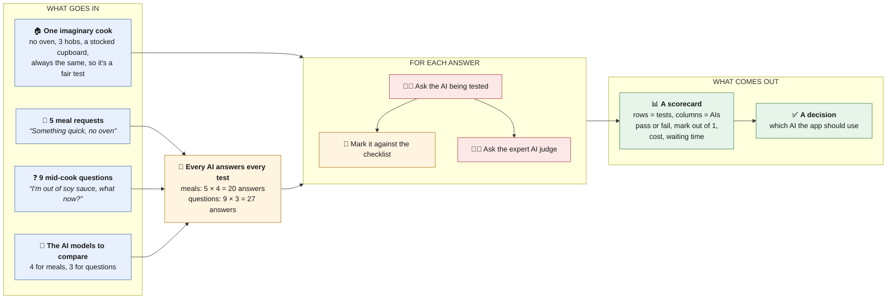
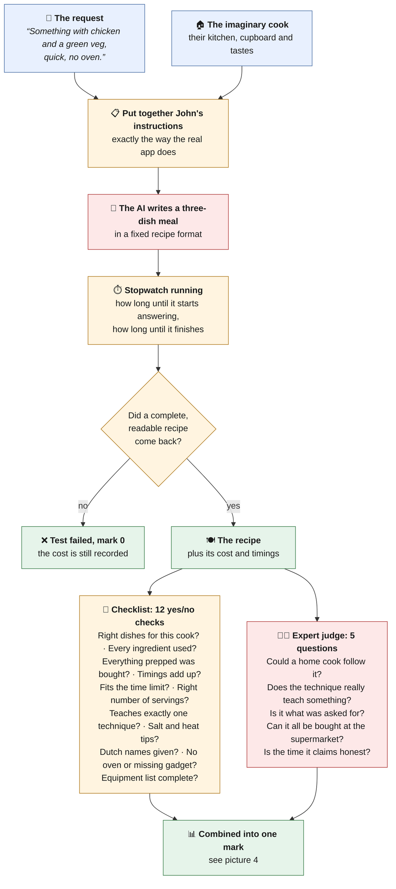
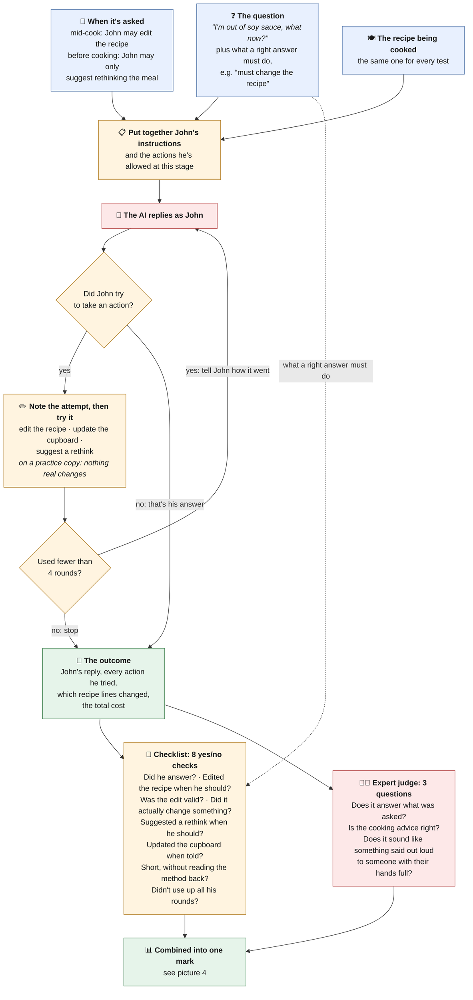
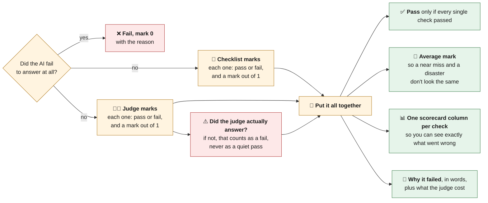

# How the test bench works, step by step

Four pictures, from the big picture down to how one test gets its final mark. Each is written to
be followed without any programming background. Under each one, a collapsed **For developers**
table says where each step lives in the code.

**Colour key, used in every diagram:**
🟦 blue = what goes in · 🟧 amber = a step the test bench does itself ·
🟥 red = a call to an AI model, which costs money · 🟩 green = what comes out

---

## 1. The big picture

There are two kinds of test, because John, the app's AI chef, does two different jobs. One is
**writing a meal** from a one-line request. The other is **answering questions while you cook**.
Each AI being compared answers every test, and every answer is marked.

Each answer costs two AI calls: one for the AI being tested and one for the judge. All 47 answers
together cost about $6.50.

<b>For developers</b>

| Step | Where it lives |
| --- | --- |
| Meal requests, mid-cook questions | `cases/generate-meal.yaml`, `cases/cook-question.yaml` |
| AIs to compare (model + effort) | the `providers:` list in `promptfoo.*.yaml` |
| The imaginary cook, the recipe asked about | `fixtures/kitchen.ts`, `fixtures/recipes.ts` |
| Every AI × every test | promptfoo builds the grid; `npm run eval:meal` / `eval:cook` |
| Ask the AI being tested | `providers/generate-meal.ts`, `providers/cook-question.ts` |
| Checklist and judge | `graders/`, combined in `asserts/` |
| Scorecard | `npm run eval:view` |
| The key it spends from | `EVAL_ANTHROPIC_API_KEY` in `.env`, never the app's key |

---

## 2. One meal test, from request to marks

What happens when one AI gets one request, such as *"Something with chicken and a green veg, quick,
no oven."*

This is the same path the real app takes, except that nothing is saved and nothing is sent to a
phone. Because the test bench uses the app's own code rather than a copy, it can't drift from what
cooks actually get.

<b>For developers</b>

| Step | Where it lives |
| --- | --- |
| John's instructions | `buildSystemBlocks` + `buildRequestPrompt` in `app/_shared/prompt/john.ts` |
| The fixed recipe format | `ModelRecipeSchema` in `app/_shared/domain/recipe.ts` (structured output) |
| The call and the stopwatch | `messages.stream()` in `providers/generate-meal.ts`: time to first token, total duration |
| The 12 checks | `meal_shape`, `roles_resolve`, `ingredients_used`, `prep_covered`, `timings_add_up`, `within_time_budget`, `servings_match`, `one_skill_node`, `cues_present`, `dutch_names`, `equipment_respected`, `equipment_listed`, in `app/_shared/domain/recipe-coherence.ts` via `graders/recipe-coherence.ts` |
| The 5 judge questions | `MEAL_RUBRIC` in `graders/judge.ts`: `cookable`, `teaches`, `fidelity`, `buyable`, `timing_realistic` (Opus 5.5 at `xhigh`) |

---

## 3. One mid-cook question, from question to marks

Here John already has a recipe in front of him, and the cook asks something. Some questions only
need words. Others need John to **do** something: change the recipe, note that the cook has run
out of something, or (before cooking has started) offer to rethink the whole meal. Each test says
in advance what the right reply has to do.

What a right answer must do is written in the test before the AI replies. If it were worked out
afterwards from what the AI did, any reply would look correct.

<b>For developers</b>

| Step | Where it lives |
| --- | --- |
| Question + expectations | `cases/cook-question.yaml`: `expect_patch`, `expect_pantry`, `expect_rethink`, `status` |
| Instructions + allowed actions | `buildCookQuestionPrompt` in `app/_shared/prompt/john.ts`; `cookToolsFor(status)` in `app/cook-question/tools.ts` |
| The reply | `messages.create()` with `tool_choice: auto`, in `providers/cook-question.ts` |
| The three actions | tools `patch_recipe` (validated and applied in memory), `update_pantry`, `suggest_rethink` (validated only); no database is touched |
| The 8 checks | `answered`, `patched_when_needed`, `patch_valid`, `patch_applied`, `rethink_when_needed`, `pantry_when_told`, `no_restating`, `turn_efficiency`, in `graders/cook-answer.ts` |
| The 3 judge questions | `COOK_RUBRIC` in `graders/judge.ts`: `answers_it`, `correct`, `spoken` |

---

## 4. How the marks become one result

Both kinds of test end the same way.

Why every check must pass: a recipe that needs an oven you don't own is useless however good the
judge thinks it is, and a recipe the judge finds bad is useless however tidy it looks.

Why the judge's silence counts as a failure: on the very first run, the judge ran out of room to
think and returned nothing. Without this rule, those tests would have looked like clean passes.

<b>For developers</b>

| Step | Where it lives |
| --- | --- |
| Combining | `toGradingResult` in `asserts/shared.ts`; every grader returns the same `MetricResult` shape |
| Judge health check | the `judge_verdict` metric |
| Pass / score / columns / reason | promptfoo's `pass`, `score` (mean), `namedScores`, `reason` |

---

## What these pictures leave out on purpose

- **Matching ingredients to the app's master ingredient list.** That list lives in the app's
  database, which the test bench doesn't connect to. Every AI is affected the same way, so the
  comparison is still fair, but this part isn't measured.
- **Savings from caching.** Every test starts from scratch, so the costs shown are the worst case.
  Real use costs less.
- **The app's spending limits.** Test runs don't count against any cook's monthly limit and don't
  show up on the app's spending dashboard.
