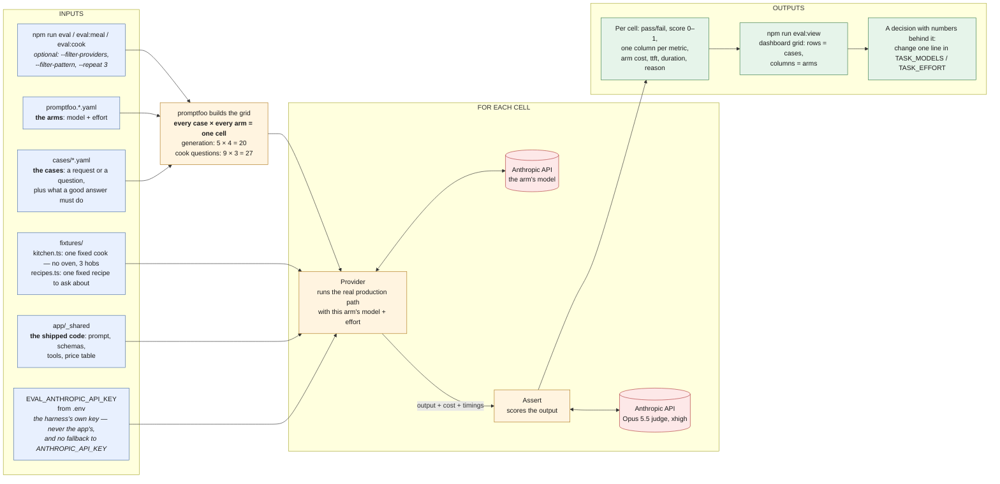
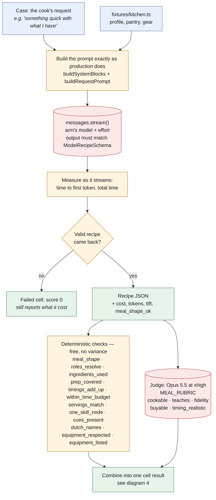
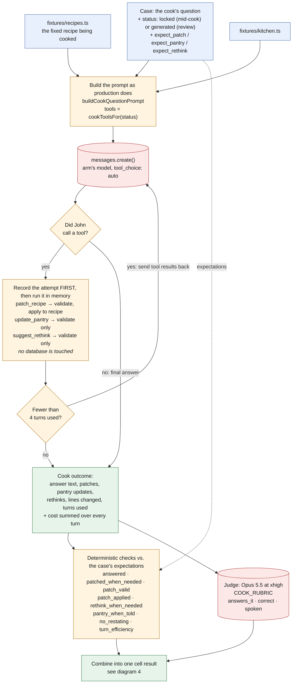
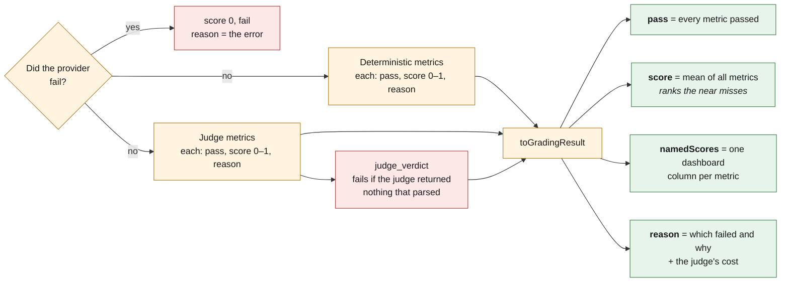

# How the eval harness works, from inputs to outputs

Four diagrams, from the big picture down to how one cell is scored. They render on GitHub and in
VS Code's Markdown preview (Mermaid). The prose in `README.md` explains *why*; these show *what
flows where*.

---

## 1. The big picture

What goes in, what promptfoo does with it, and what comes out.

**Key:** blue = inputs · amber = the harness's own steps · red = a paid API call · green = outputs.

Two paid calls per cell: the arm being tested (what the cost column shows) and the judge (measurement
overhead, about $0.14 a cell, shown in the cell's reason). A full run is about $6.50.

---

## 2. Inside one generation cell

`providers/generate-meal.ts` → `asserts/meal.ts`. Input: one line a cook might type. Output: a
recipe and its scores.

Nothing is saved and nothing is streamed to a phone. Otherwise this is the `generate-meal`
handler's path, imported from `_shared`, so the eval cannot drift from what ships.

---

## 3. Inside one cook-question cell

`providers/cook-question.ts` → `asserts/cook.ts`. Input: a question asked from John's bottom sheet,
about a recipe that already exists. Output: John's answer, every tool call he tried, and scores.

The expectations come from the case, not from what the model did. If they were inferred, any choice
the model made would look correct.

---

## 4. How a cell becomes one score

`asserts/shared.ts`. The same for both suites, which is why every grader returns the same
`MetricResult` shape.

A cell passes only if **every** metric passes: a recipe that needs an oven the cook doesn't own is
unusable whatever the judge thinks, and a recipe the judge finds bad is unusable however tidy its
structure. The mean score is there so a near miss and a disaster still read differently.

---

## What the diagrams leave out on purpose

- **Canonical ingredient resolution.** The canonical list lives in the database seed, so in an eval
  run every line resolves to nothing. That is the same for every arm, so comparisons hold, but the
  pantry check isn't measured. (`RESOLVES_AGAINST_CANONICAL` in `fixtures/kitchen.ts`.)
- **Prompt caching.** Every cell starts cold, so the cost column is the uncached worst case.
- **The spend ledger.** Eval calls don't go through `recordModelCall`, so they don't count against
  any cook's cap and don't appear on the spend dashboard.
